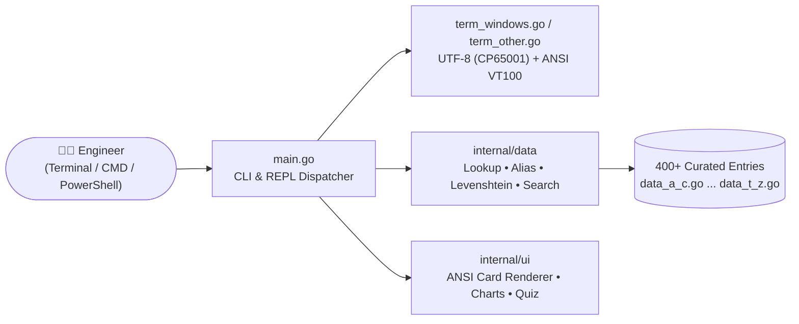

<div align="center">

```text
╔═══════════════════════════════════════════════════════════════════════════════╗
║    _____                                             .__                      ║
║   /  _  \   ____ _______  ____   ____   ____   _____ |__| ____  ____   ____   ║
║  /  /_\  \_/ ___\\_  __ \/  _ \ /    \ /  _ \ /     \|  |/ ___\/  _ \ /    \  ║
║ /    |    \  \___ |  | \(  <_> )   |  (  <_> )  Y Y  \  \  \__(  <_> )   |  \ ║
║ \____|__  /\___  >|__|   \____/|___|  /\____/|__|_|  /__|\___  >____/|___|  / ║
║         \/     \/                   \/             \/        \/           \/  ║
║         ✦  THE BIBLE OF CLOUD TECH ACRONYMS • 400+ Entries (A–Z)  ✦           ║
╚═══════════════════════════════════════════════════════════════════════════════╝
```

# 📖 THE ACRONOMICON

### *The Sacred Terminal Grimoire of Cloud, Kubernetes, Security, Networking & DevOps Acronyms*

[](https://go.dev/)
[-success?style=for-the-badge&logo=checkmarx&logoColor=white)](#️-under-the-hood)
[-f59e0b?style=for-the-badge&logo=bookstack&logoColor=white)](#-the-ten-sacred-tomes-categories)
[](#-installation)

<p align="center">
  <em>"And on the eighth day, the Principal Architects spoke exclusively in three-letter initialisms,<br/>
  and nobody on the Sev-1 bridge knew whether <code>CNAPP</code> was a firewall, a breakfast cereal, or a CNI plugin."</em>
</p>

[⚡ Quick Start](#-quick-start) •
[📦 Installation](#-installation) •
[🖥️ Terminal Showcase](#️-terminal-showcase) •
[📚 The 10 Tomes](#-the-ten-sacred-tomes-categories) •
[🪄 Grimoire of Spells](#-grimoire-of-spells-cli--repl) •
[🛠️ Building](#️-building--packaging-from-source)

</div>

---

## ⚡ Why Does The Acronomicon Exist?

Modern cloud engineering is **90% YAML indentation** and **10% nodding confidently** when someone on a Zoom call says:

> *"We need to verify our **CSPM** and **CWPP** posture inside the **CNAPP** before we cut over the **Multi-AZ** **EKS** **ALBs** from **SNAT** to **IPv6** **CIDR** blocks with **mTLS** via **eBPF** and **IRSA** to hit our **SOC 2** **RTO**/**RPO** **SLOs**."*

**The Acronomicon** is a blazing-fast, zero-dependency, full-color CLI and interactive REPL written in pure Go that lives right in your terminal. Type any acronym—or even a half-remembered typo during a 3:00 AM outage—and get:

1. 🏷️ **What It Stands For** (plus aliases like `K8s` ↔ `KUBERNETES`, `AAD` ↔ `ENTRA`)
2. ☁️ **Provider & Category Badges** (`Cloud-Agnostic`, `AWS`, `GCP`, `Azure`, `CNCF`)
3. ⚡ **Meaning (TL;DR)** — A crisp, no-fluff one-sentence definition
4. 🧠 **What It Does & Why It Matters** — How it actually works under the hood and why engineers care
5. 🛠️ **In Practice / Real-World Example** — Concrete production scenarios, commands, or architecture patterns
6. 🔗 **See Also Graph** — Related acronyms to rabbit-hole through next

---

## 🖥️ Terminal Showcase

### 1. Instant Full-Color Acronym Cards (`acronomicon k8s`)

```text
╭──────────────────────────────────────────────────────────────────────────────╮
│  [ K8s ] (aka KUBERNETES, KUBE)   [CNCF]  [Containers & K8s]                 │
│  ✦ Kubernetes                                                                │
├──────────────────────────────────────────────────────────────────────────────┤
│  MEANING (TL;DR)                                                             │
│  The de facto open-source container orchestration platform for automating    │
│  deployment, scaling, networking, and self-healing of containerized          │
│  applications.                                                               │
│                                                                              │
│  WHAT IT DOES & WHY IT MATTERS                                               │
│  The numeronym 'K8s' replaces the 8 letters between 'K' and 's' in           │
│  Kubernetes (Greek for helmsman). Inspired by Google's internal Borg system  │
│  and donated to launch the CNCF in 2015, Kubernetes continuously reconciles  │
│  actual cluster state toward declarative desired state across Pods,          │
│  Services, Deployments, and StatefulSets.                                    │
│                                                                              │
│  IN PRACTICE / REAL-WORLD EXAMPLE                                            │
│  ▸ Declaring a Kubernetes Deployment with 5 replicas and a RollingUpdate     │
│  ▸ strategy so zero-downtime releases and crashed-node rescheduling happen   │
│  ▸ automatically.                                                            │
├──────────────────────────────────────────────────────────────────────────────┤
│  See Also: EKS • GKE • AKS • ETCD • CNI • CSI • CRI • HELM                   │
╰──────────────────────────────────────────────────────────────────────────────╯
```

### 2. Deep Technical Explanations (`acronomicon ebpf`)

```text
╭──────────────────────────────────────────────────────────────────────────────╮
│  [ eBPF ]   [Cloud-Agnostic]  [Networking]                                   │
│  ✦ Extended Berkeley Packet Filter                                           │
├──────────────────────────────────────────────────────────────────────────────┤
│  MEANING (TL;DR)                                                             │
│  A revolutionary Linux kernel technology that runs sandboxed, JIT-compiled   │
│  programs directly inside the kernel without modifying kernel source code    │
│  or loading kernel modules.                                                  │
│                                                                              │
│  WHAT IT DOES & WHY IT MATTERS                                               │
│  eBPF lets cloud-native tools attach safe, verifier-checked bytecode hooks   │
│  to network sockets, syscalls, tracepoints, and kernel functions. It powers  │
│  next-generation Kubernetes CNI networking (Cilium), sidecarless service     │
│  meshes, zero-overhead continuous profiling, and runtime security            │
│  enforcement (Falco/Tetragon) while bypassing legacy iptables bottlenecks.   │
│                                                                              │
│  IN PRACTICE / REAL-WORLD EXAMPLE                                            │
│  ▸ Replacing kube-proxy's thousands of sequential iptables rules with        │
│  ▸ Cilium eBPF hash-table lookups for O(1) packet routing at 40Gbps+.        │
├──────────────────────────────────────────────────────────────────────────────┤
│  See Also: CNI • XDP • IPTABLES • K8s • SIDECAR •CWPP                        │
╰──────────────────────────────────────────────────────────────────────────────╯
```

### 3. Interactive REPL Mode (`acronomicon`)

Run `acronomicon` with no arguments to enter the interactive shell:

```text
  Welcome to The Acronomicon! Type any acronym (e.g. k8s, vpc, ebpf, mtls),
  a single letter (a–z), ?<search>, /cat, /random, /quiz, /help, or q to exit.

acronomicon> mtls
```

### 4. Interactive Cloud Quiz Mode (`acronomicon quiz`)

Test your cloud architecture street cred—or grill your teammates before certification exams:

```text
╔═══════════════════════════════════════════════════════════════════════════════╗
║  🧠  THE ACRONOMICON TRIAL BY FIRE • CLOUD TECH QUIZ (5 Questions)            ║
╚═══════════════════════════════════════════════════════════════════════════════╝

  Question 1 of 5  [Security & Identity • Cloud-Agnostic]
  What does the acronym  CNAPP  stand for?

    [1] Cloud-Native Application Protection Platform
    [2] Container Network Address Port Proxy
    [3] Centralized Node Authentication Policy Provider
    [4] Cloud Network Access Provisioning Protocol

  Your answer (1-4, or 'q' to quit): 1
  ✔ Correct! CNAPP = Cloud-Native Application Protection Platform
    ↳ A unified security platform combining CSPM, CWPP, CIEM, and IaC scanning...
```

### 5. Database Telemetry & A–Z Distribution (`acronomicon stats`)

```text
╭──────────────────────────────────────────────────────────────────────────────╮
│  📊 THE ACRONOMICON DATABASE STATISTICS (400 Total Entries)                  │
├──────────────────────────────────────────────────────────────────────────────┤
│  BY CATEGORY                                                                 │
│  Security & Identity          ████████████████████████               95      │
│  Networking                   ██████████████████                     73      │
│  Containers & K8s             █████████████                          53      │
│  Storage & Databases          ████████████                           49      │
│  Compute                      ████████                               31      │
│  Architecture & Cloud Models  ██████                                 24      │
│  DevOps & IaC                 █████                                  20      │
│  Observability & SRE          █████                                  20      │
│  Compliance & Governance      ████                                   18      │
│  Serverless & Messaging       ████                                   17      │
╰──────────────────────────────────────────────────────────────────────────────╯
```

---

## 📦 Installation

### 🍎 macOS (Apple Silicon `arm64` & Intel `x86_64`)

Choose whichever path fits your workflow:

| Method | How to Install |
| :--- | :--- |
| **Native `.pkg` GUI Installer** | Double-click **`dist/acronomicon-macos-universal.pkg`**. Installs `/usr/local/bin/acronomicon` (plus `/opt/homebrew/bin/acronomicon` symlink) and `/Applications/Acronomicon.app`. |
| **macOS `.app` Bundle** | Drag **`dist/Acronomicon.app`** to `/Applications` and launch via **Spotlight (`⌘ + Space` → `Acronomicon`)**. Automatically opens `Terminal.app` into the interactive REPL. |
| **No-Sudo User Installer** | Double-click **`Install Acronomicon.command`** inside the macOS `.zip` package to install to `~/.local/bin` and `~/Applications`. |

### 🪟 Windows (Windows 10 / 11 • `x64` & `ARM64`)

Built with native Windows `kernel32.dll` **Virtual Terminal Processing (`ENABLE_VIRTUAL_TERMINAL_PROCESSING`)** and **UTF-8 (`CP65001`)** console initialization—meaning full ANSI colors and Unicode box-drawing characters work out of the box in **Windows Terminal**, **PowerShell**, and classic **`cmd.exe`**.

| Method | How to Install |
| :--- | :--- |
| **One-Click Setup Wizard (`*-setup.exe`)** | Run **`dist/acronomicon-windows-amd64-setup.exe`** (or `arm64`). Installs to `%LOCALAPPDATA%\Programs\Acronomicon` (no Admin/UAC required), adds `acronomicon` to your Windows User `PATH`, creates **Start Menu** & **Desktop** shortcuts, and registers an uninstaller in **Windows Installed Apps**. |
| **Silent / Unattended Install** | `acronomicon-windows-amd64-setup.exe --silent` (and `--uninstall` to remove cleanly). |
| **Portable `.exe`** | Run **`dist/acronomicon-windows-amd64.exe`** directly from anywhere—zero installation required. |

### 🐹 Go Developers (Any OS: macOS, Linux, Windows, BSD)

```bash
go install github.com/espresso20/acronomicon@latest
```

---

## 🚀 Quick Start

```bash
# 1. Launch interactive REPL mode (with ASCII banner & prompt)
acronomicon

# 2. Look up any acronym directly (case-insensitive, supports aliases)
acronomicon k8s
acronomicon vpc
acronomicon ebpf
acronomicon sase

# 3. Fat-fingered an acronym at 3 AM? Fuzzy Levenshtein suggestions have your back:
acronomicon kubernets

# 4. Full-text ranked search across all 400+ acronyms, meanings & examples
acronomicon search "zero trust"
acronomicon -s "load balancer"

# 5. Browse by letter (A–Z) or view the full alphabet index
acronomicon list
acronomicon list s

# 6. Browse by cloud category
acronomicon category
acronomicon category security

# 7. Pull a random "Acronomicon Verse of the Day"
acronomicon random

# 8. Take the 5-question multiple-choice Trial by Fire
acronomicon quiz
```

---

## 📚 The Ten Sacred Tomes (Categories)

The Acronomicon organizes **400+ acronyms** across **10 core engineering disciplines** and **5 ecosystem tags** (`Cloud-Agnostic`, `AWS`, `Azure`, `GCP`, `CNCF`):

| Tome (Category) | Count | Sample Acronyms Inside |
| :--- | :---: | :--- |
| 🔐 **Security & Identity** | **95** | `IAM`, `mTLS`, `OIDC`, `OAuth`, `SAML`, `RBAC`, `ABAC`, `ZTNA`, `SASE`, `CNAPP`, `CSPM`, `CWPP`, `SIEM`, `SOAR`, `KMS`, `HSM`, `PKI`, `IRSA`, `WAF`, `SSRF` |
| 🌐 **Networking** | **73** | `VPC`, `CIDR`, `BGP`, `ANYCAST`, `eBPF`, `XDP`, `NAT`, `SNAT`, `ALB`, `NLB`, `GWLB`, `TGW`, `VXLAN`, `GENEVE`, `MPLS`, `SD-WAN`, `QUIC`, `gRPC`, `DNSSEC` |
| ☸️ **Containers & K8s** | **53** | `K8s`, `K3s`, `EKS`, `GKE`, `AKS`, `CNI`, `CSI`, `CRI`, `CRD`, `ETCD`, `HELM`, `HPA`, `VPA`, `KEDA`, `OCI`, `CGROUPS`, `OOM`, `SIDECAR`, `ISTIO` |
| 💾 **Storage & Databases** | **49** | `S3`, `EBS`, `EFS`, `RDS`, `NVMe`, `IOPS`, `SAN`, `NAS`, `RAID`, `ZFS`, `OLTP`, `OLAP`, `ACID`, `BASE`, `CAP`, `MVCC`, `WAL`, `RAFT`, `PAXOS`, `CDC` |
| ⚡ **Compute** | **31** | `EC2`, `GCE`, `VM`, `KVM`, `QEMU`, `HVM`, `NITRO`, `vCPU`, `ARM`, `NUMA`, `SR-IOV`, `DPDK`, `RDMA`, `GPU`, `TPU`, `FPGA`, `ASG`, `MIG`, `VMSS` |
| 🏛️ **Architecture & Cloud Models** | **24** | `IaaS`, `PaaS`, `SaaS`, `FaaS`, `CaaS`, `DBaaS`, `XaaS`, `MSA`, `SOA`, `EDA`, `CQRS`, `SAGA`, `BFF`, `HA`, `DR`, `RTO`, `RPO`, `SPOF`, `MULTI-AZ` |
| 🔄 **DevOps & IaC** | **20** | `CI/CD`, `IaC`, `GitOps`, `TF`, `TOFU`, `CDK`, `CFN`, `ARM`, `BICEP`, `SBOM`, `SLSA`, `DORA`, `BLUE/GREEN`, `CANARY`, `IMMUTABLE` |
| 📈 **Observability & SRE** | **20** | `SRE`, `SLA`, `SLO`, `SLI`, `OTel`, `APM`, `RUM`, `LGTM`, `PROM`, `ELK`, `MTBF`, `MTTD`, `MTTR`, `RED`, `USE`, `AIOps`, `CHAOS` |
| 📜 **Compliance & Governance** | **18** | `SOC 2`, `ISO 27001`, `HIPAA`, `PCI DSS`, `GDPR`, `CCPA`, `FedRAMP`, `FIPS`, `NIST`, `CIS`, `FinOps`, `CAPEX`, `OPEX`, `TCO`, `RI`, `SAVINGS PLAN` |
| 📨 **Serverless & Messaging** | **17** | `LAMBDA`, `SQS`, `SNS`, `SES`, `EVENTBRIDGE`, `PUB/SUB`, `KAFKA`, `MSK`, `DLQ`, `FIFO`, `AMQP`, `MQTT`, `WASM`, `WASI`, `DAPR`, `KNATIVE` |

---

## 🪄 Grimoire of Spells (CLI & REPL)

### Command-Line Flags & Subcommands

| Command | Alias / Short | Description |
| :--- | :--- | :--- |
| `acronomicon` | *(none)* | Launch interactive `acronomicon>` REPL mode |
| `acronomicon <acronym>` | e.g. `acronomicon vpc` | Display the full-color reference card for `<acronym>` |
| `acronomicon <letter>` | e.g. `acronomicon k` | List all acronyms starting with `<letter>` (`a`–`z`) |
| `acronomicon search <q>` | `-s`, `--search`, `find` | Ranked full-text search across acronyms, meanings & examples |
| `acronomicon list [letter]` | `-l`, `--list`, `ls` | Show the A–Z summary grid or list entries for a letter |
| `acronomicon category [c]` | `-c`, `cat`, `categories` | List all 10 categories or filter entries by category name |
| `acronomicon random` | `-r`, `rand`, `verse` | Summon a random *Acronomicon Verse of the Day* |
| `acronomicon quiz` | `-q`, `--quiz` | Start an interactive 5-question multiple-choice quiz |
| `acronomicon stats` | `stat`, `--stats` | Render database breakdown charts by category, provider & A–Z |
| `acronomicon help` | `-h`, `--help`, `/?` | Show CLI usage and interactive command guide |
| `--no-color` | `NO_COLOR=1` | Strip ANSI escape codes for plain-text piping or logs |

### Interactive REPL Shortcuts (`acronomicon>`)

| Input | Action |
| :--- | :--- |
| `<acronym>` (e.g. `iam`, `cidr`, `s3`) | Look up the acronym card (or show fuzzy suggestions) |
| `a` – `z` (any single letter) | Display the table of all acronyms starting with that letter |
| `?<keyword>` or `/search <keyword>` | Search across all 400+ definitions and examples |
| `/cat` or `/cat <name>` | Browse all categories or inspect a specific category |
| `/r` or `/random` | Pull a random acronym card |
| `/quiz` | Launch a 5-question multiple-choice quiz round |
| `/stats` | Print category, provider, and A–Z bar charts |
| `/list` | Show the A–Z index summary |
| `/help` or `?` | Show interactive REPL help |
| `q`, `quit`, `exit` | Close the Acronomicon |

---

## ⚙️ Under the Hood



- **100% Pure Go Standard Library**: Zero external modules in `go.mod`. Compiles in `<1 second` completely offline with `CGO_ENABLED=0`.
- **Smart Fuzzy Matching**: Combines punctuation/case normalization (`SD-WAN` == `sdwan`, `K8s` == `k8s`), alias indexing (`KUBERNETES` → `K8s`), substring matching, and **Levenshtein edit-distance scoring** so typos still surface the right acronym.
- **True Cross-Platform Terminal Rendering**: On Windows, `term_windows.go` calls `kernel32.dll` (`SetConsoleOutputCP(65001)`, `SetConsoleCP(65001)`, and `SetConsoleMode` with `ENABLE_VIRTUAL_TERMINAL_PROCESSING`) so Unicode box borders (`╭─╮│╰─╯`) and 16-color/bright ANSI sequences render cleanly in both `cmd.exe` and PowerShell.

---

## 🛠️ Building & Packaging from Source

```bash
# Run the test suite (verifies 400+ entries, zero duplicates, A-Z coverage, search & fuzzy matching)
make test

# Build local binary
make build

# Build all Windows (.exe + Setup Wizards) and macOS Universal binaries
make dist
```

### Project Layout

```text
acronomicon/
├── main.go                        # CLI dispatcher & interactive REPL loop
├── term_windows.go                # Windows kernel32 VT100 + UTF-8 console initializer
├── term_other.go                  # Unix/macOS terminal initializer
├── Makefile                       # Build, test, and cross-compilation targets
├── cmd/
│   └── windows-installer/         # Self-contained Windows Setup Wizard (//go:embed)
├── internal/
│   ├── data/
│   │   ├── types.go               # Entry struct, Lookup, Suggest (Levenshtein), Search
│   │   ├── data_a_c.go            # Curated acronyms A–C
│   │   ├── data_d_f.go            # Curated acronyms D–F
│   │   ├── data_g_l.go            # Curated acronyms G–L
│   │   ├── data_m_p.go            # Curated acronyms M–P
│   │   ├── data_q_s.go            # Curated acronyms Q–S
│   │   ├── data_t_z.go            # Curated acronyms T–Z
│   │   ├── data_extra.go          # Deep-cut Cloud, K8s & Security expansions
│   │   ├── data_extra2.go         # Architecture, Storage & Networking expansions
│   │   └── data_test.go           # Integrity & search unit tests
│   └── ui/
│       └── ui.go                  # Full-color ANSI card renderer, charts & quiz engine
└── packaging/
    ├── macos/                     # macOS .pkg installer & Acronomicon.app bundle assets
    └── windows/                   # Windows PowerShell installer scripts & batch launcher
```

---

<div align="center">
  <strong>May your latencies be low, your pods never <code>OOMKilled</code>, and your <code>SLA</code>s five nines. 📖✨</strong>
</div>
