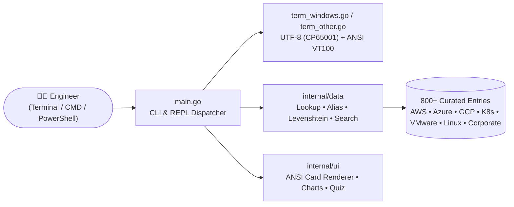

<div align="center">

```text
╔═══════════════════════════════════════════════════════════════════════════════╗
║    _____                                             .__                      ║
║   /  _  \   ____ _______  ____   ____   ____   _____ |__| ____  ____   ____   ║
║  /  /_\  \_/ ___\\_  __ \/  _ \ /    \ /  _ \ /     \|  |/ ___\/  _ \ /    \  ║
║ /    |    \  \___ |  | \(  <_> )   |  (  <_> )  Y Y  \  \  \__(  <_> )   |  \ ║
║ \____|__  /\___  >|__|   \____/|___|  /\____/|__|_|  /__|\___  >____/|___|  / ║
║         \/     \/                   \/             \/        \/           \/  ║
║         ✦  THE BIBLE OF CLOUD TECH ACRONYMS • 800+ Entries (A–Z)  ✦           ║
╚═══════════════════════════════════════════════════════════════════════════════╝
```

# 📖 THE ACRONOMICON

### *The Sacred Terminal Grimoire of Cloud, Kubernetes, Security, Networking, DevOps & Manager Speak*

[](https://go.dev/)
[-success?style=for-the-badge&logo=checkmarx&logoColor=white)](#️-under-the-hood)
[-f59e0b?style=for-the-badge&logo=bookstack&logoColor=white)](#-the-eleven-sacred-tomes-categories)
[](#-installation)

<p align="center">
  <em>"And on the eighth day, the Principal Architects spoke exclusively in three-letter initialisms,<br/>
  and nobody on the Sev-1 bridge knew whether <code>CNAPP</code> was a firewall, a breakfast cereal, or a CNI plugin."</em>
</p>

[⚡ Quick Start](#-quick-start) •
[📦 Installation](#-installation) •
[🖥️ Terminal Showcase](#️-terminal-showcase) •
[👔 Manager Speak Tome](#-the-eleven-sacred-tomes-categories) •
[📚 The 11 Tomes](#-the-eleven-sacred-tomes-categories) •
[🪄 Grimoire of Spells](#-grimoire-of-spells-cli--repl) •
[🛠️ Building](#️-building--packaging-from-source)

</div>

---

## ⚡ Why Does The Acronomicon Exist?

Modern cloud engineering is **90% YAML indentation** and **10% nodding confidently** when someone on a Zoom call says:

> *"We need to verify our **CSPM** and **CWPP** posture inside the **CNAPP** before we cut over the **Multi-AZ** **EKS** **ALBs** from **SNAT** to **IPv6** **CIDR** blocks with **mTLS** via **eBPF** and **IRSA** to hit our **SOC 2** **RTO**/**RPO** **SLOs**—so let's **circle back** after the **standup** before our **1:1** to avoid a **PIP**."*

**The Acronomicon** is a blazing-fast, zero-dependency, full-color CLI and interactive REPL written in pure Go that lives right in your terminal. Covering **800+ acronyms** across **AWS, Azure, GCP, Kubernetes, Docker, VMware, Linux, Red Hat, SUSE, Enterprise Networking**, and a bonus **Corporate & Manager Speak** section, each entry delivers:

1. 🏷️ **What It Stands For** (plus aliases like `K8s` ↔ `KUBERNETES`, `ENTRA-ID` ↔ `AAD`, `1ON1` ↔ `1:1`)
2. ☁️ **Provider & Category Badges** (`Cloud-Agnostic`, `AWS`, `Azure`, `GCP`, `CNCF`, `VMware`, `Red Hat`, `SUSE`, `Linux`, `👔 Corporate`)
3. ⚡ **Meaning (TL;DR)** — A crisp, no-fluff one-sentence summary
4. 🧠 **What It Does & Why It Matters** — How it actually works under the hood (or why HR uses it to terrorize engineers)
5. 🛠️ **In Practice / Real-World Example** — Concrete production commands, real architecture patterns, or cynical corporate dialogue
6. 🔗 **See Also Graph** — Related acronyms to rabbit-hole through next

---

## 🖥️ Terminal Showcase

### 1. Instant Cloud Architecture Cards (`acronomicon k8s`)

```text
╭──────────────────────────────────────────────────────────────────────────────╮
│  [ K8s ] (aka KUBERNETES, KUBE)   [CNCF]  [Containers & K8s]                 │
│  ✦ Kubernetes                                                                │
├──────────────────────────────────────────────────────────────────────────────┤
│  MEANING (TL;DR)                                                             │
│  The de facto open-source container orchestration platform for automating    │
│  deployment, scaling, networking, and self-healing of containerized          │
│  applications.                                                               │
│                                                                              │
│  WHAT IT DOES & WHY IT MATTERS                                               │
│  The numeronym 'K8s' replaces the 8 letters between 'K' and 's' in           │
│  Kubernetes (Greek for helmsman). Inspired by Google's internal Borg system  │
│  and donated to launch the CNCF in 2015, Kubernetes continuously reconciles  │
│  actual cluster state toward declarative desired state across Pods,          │
│  Services, Deployments, and StatefulSets.                                    │
│                                                                              │
│  IN PRACTICE / REAL-WORLD EXAMPLE                                            │
│  ▸ Declaring a Kubernetes Deployment with 5 replicas and a RollingUpdate     │
│  ▸ strategy so zero-downtime releases and crashed-node rescheduling happen   │
│  ▸ automatically.                                                            │
├──────────────────────────────────────────────────────────────────────────────┤
│  See Also: EKS • GKE • AKS • ETCD • CNI • CSI • CRI • HELM                   │
╰──────────────────────────────────────────────────────────────────────────────╯
```

### 2. Disrespectful & Irreverent Manager Speak (`acronomicon pip`)

```text
╭──────────────────────────────────────────────────────────────────────────────╮
│  [ PIP ] (aka PERFORMANCE IMPROVEMENT PLAN)   [👔 Corporate]  [Corporate & Manager Speak]  │
│  ✦ Performance Improvement Plan                                              │
├──────────────────────────────────────────────────────────────────────────────┤
│  MEANING (TL;DR)                                                             │
│  Paid Interview Period; HR's legally mandated two-week head start for you    │
│  to polish your resume and steal office supplies before your laptop gets     │
│  remotely wiped.                                                             │
│                                                                              │
│  WHAT IT DOES & WHY IT MATTERS                                               │
│  A formal documentation trail constructed by HR and a cowardly manager to    │
│  protect the company against wrongful termination lawsuits. Once placed on   │
│  a PIP, the completion criteria will be mathematically impossible (e.g.,     │
│  'Rewrite the Kubernetes networking stack in assembly in 10 business         │
│  days').                                                                     │
│                                                                              │
│  IN PRACTICE / REAL-WORLD EXAMPLE                                            │
│  ▸ 'My manager put me on a 30-day PIP for missing a deadline, so I spent     │
│  ▸ the last 28 days interviewing at our primary competitor and got a 40%     │
│  ▸ raise.'                                                                   │
├──────────────────────────────────────────────────────────────────────────────┤
│  See Also: RIF • 1ON1 • OKRS • TC                                            │
╰──────────────────────────────────────────────────────────────────────────────╯
```

### 3. Deep Linux & Hypervisor Cards (`acronomicon esxi`)

```text
╭──────────────────────────────────────────────────────────────────────────────╮
│  [ ESXI ] (aka VMWARE ESXI, ESX)   [VMware]  [Compute]                       │
│  ✦ VMware ESXi (Elastic Sky X Integrated)                                    │
├──────────────────────────────────────────────────────────────────────────────┤
│  MEANING (TL;DR)                                                             │
│  VMware's industry-standard bare-metal Type-1 hypervisor that installs       │
│  directly onto physical server hardware.                                     │
│                                                                              │
│  WHAT IT DOES & WHY IT MATTERS                                               │
│  Directly controls hardware resources with a tiny footprint (approx. 150MB)  │
│  using its proprietary VMkernel microkernel. Partitions physical CPU,        │
│  memory, networking, and storage into isolated virtual machines with         │
│  near-zero virtualization overhead.                                          │
│                                                                              │
│  IN PRACTICE / REAL-WORLD EXAMPLE                                            │
│  ▸ Installing VMware ESXi 8.0 on a Dell PowerEdge blade server with dual     │
│  ▸ 64-core AMD EPYC processors and 1TB of RAM.                               │
├──────────────────────────────────────────────────────────────────────────────┤
│  See Also: VSPHERE • VCENTER • VMKERNEL • KVM                                │
╰──────────────────────────────────────────────────────────────────────────────╯
```

### 4. Interactive Cloud Quiz Mode (`acronomicon quiz`)

Test your architecture street cred—or quiz your teammates before certification exams:

```text
╔═══════════════════════════════════════════════════════════════════════════════╗
║  🧠  THE ACRONOMICON TRIAL BY FIRE • CLOUD TECH QUIZ (5 Questions)            ║
╚═══════════════════════════════════════════════════════════════════════════════╝

  Question 1 of 5  [Security & Identity • Cloud-Agnostic]
  What does the acronym  CNAPP  stand for?

    [1] Cloud-Native Application Protection Platform
    [2] Container Network Address Port Proxy
    [3] Centralized Node Authentication Policy Provider
    [4] Cloud Network Access Provisioning Protocol

  Your answer (1-4, or 'q' to quit): 1
  ✔ Correct! CNAPP = Cloud-Native Application Protection Platform
    ↳ A unified security platform combining CSPM, CWPP, CIEM, and IaC scanning...
```

### 5. Database Telemetry & A–Z Distribution (`acronomicon stats`)

```text
📊 THE ACRONOMICON DATABASE STATISTICS
════════════════════════════════════════════════════════════════════════
  Total Cloud Acronyms: 806

🗂️  ACRONOMICON CATEGORIES
──────────────────────────────────────────────────────────────────
   1. Security & Identity            141 acronyms   ████████████████████████████████████████
   2. Containers & K8s               123 acronyms   ███████████████████████████████████
   3. Networking                     119 acronyms   ██████████████████████████████████
   4. Storage & Databases             99 acronyms   ████████████████████████████
   5. Compute                         92 acronyms   ██████████████████████████
   6. Corporate & Manager Speak       72 acronyms   ████████████████████
   7. DevOps & IaC                    42 acronyms   ████████████
   8. Architecture & Cloud Models     33 acronyms   █████████
   9. Observability & SRE             33 acronyms   █████████
  10. Compliance & Governance         26 acronyms   ███████
  11. Serverless & Messaging          26 acronyms   ███████
──────────────────────────────────────────────────────────────────
☁️  BY CLOUD PROVIDER / ECOSYSTEM
──────────────────────────────────────────────────────────────────
  [Cloud-Agnostic]      300 ( 37.2%)  ▓▓▓▓▓▓▓▓▓▓▓▓▓▓
  [AWS]                 130 ( 16.1%)  ▓▓▓▓▓▓
  [CNCF]                108 ( 13.4%)  ▓▓▓▓▓
  [👔 Corporate]          72 (  8.9%)  ▓▓▓
  [Azure]                58 (  7.2%)  ▓▓
  [GCP]                  52 (  6.5%)  ▓▓
  [VMware]               32 (  4.0%)  ▓
  [Red Hat]              24 (  3.0%)  ▓
  [Linux]                14 (  1.7%)  ▓
  [SUSE]                 12 (  1.5%)  ▓
  [Docker]                4 (  0.5%)  ▓
```

---

## 📦 Installation

### 🍎 macOS (Apple Silicon `arm64` & Intel `x86_64`)

Choose whichever path fits your workflow:

| Method | How to Install |
| :--- | :--- |
| **Native `.pkg` GUI Installer** | Double-click **`dist/acronomicon-macos-universal.pkg`**. Installs `/usr/local/bin/acronomicon` (plus `/opt/homebrew/bin/acronomicon` symlink) and `/Applications/Acronomicon.app`. |
| **macOS `.app` Bundle** | Drag **`dist/Acronomicon.app`** to `/Applications` and launch via **Spotlight (`⌘ + Space` → `Acronomicon`)**. Automatically opens `Terminal.app` into the interactive REPL. |
| **No-Sudo User Installer** | Double-click **`Install Acronomicon.command`** inside the macOS `.zip` package to install to `~/.local/bin` and `~/Applications`. |

### 🪟 Windows (Windows 10 / 11 • `x64` & `ARM64`)

Built with native Windows `kernel32.dll` **Virtual Terminal Processing (`ENABLE_VIRTUAL_TERMINAL_PROCESSING`)** and **UTF-8 (`CP65001`)** console initialization—meaning full ANSI colors and Unicode box-drawing characters work out of the box in **Windows Terminal**, **PowerShell**, and classic **`cmd.exe`**.

| Method | How to Install |
| :--- | :--- |
| **One-Click Setup Wizard (`*-setup.exe`)** | Run **`dist/acronomicon-windows-amd64-setup.exe`** (or `arm64`). Installs to `%LOCALAPPDATA%\Programs\Acronomicon` (no Admin/UAC required), adds `acronomicon` to your Windows User `PATH`, creates **Start Menu** & **Desktop** shortcuts, and registers an uninstaller in **Windows Installed Apps**. |
| **Silent / Unattended Install** | `acronomicon-windows-amd64-setup.exe --silent` (and `--uninstall` to remove cleanly). |
| **Portable `.exe`** | Run **`dist/acronomicon-windows-amd64.exe`** directly from anywhere—zero installation required. |

### 🐹 Go Developers (Any OS: macOS, Linux, Windows, BSD)

```bash
go install github.com/espresso20/acronomicon@latest
```

---

## 🚀 Quick Start

```bash
# 1. Launch interactive REPL mode (with ASCII banner & prompt)
acronomicon

# 2. Look up any tech acronym directly (case-insensitive, supports aliases)
acronomicon k8s
acronomicon vpc
acronomicon ebpf
acronomicon esxi
acronomicon rhel

# 3. Look up corporate & manager speak
acronomicon pip
acronomicon rto-office
acronomicon mvp
acronomicon bandwidth

# 4. Fat-fingered an acronym at 3 AM? Fuzzy Levenshtein suggestions have your back:
acronomicon kubernets

# 5. Full-text ranked search across all 800+ definitions, meanings & examples
acronomicon search "zero trust"
acronomicon -s "layoff"

# 6. Browse by letter (A–Z) or view the full alphabet index
acronomicon list
acronomicon list s

# 7. Browse by cloud category
acronomicon category
acronomicon category "Corporate"
acronomicon category "Containers"

# 8. Pull a random "Acronomicon Verse of the Day"
acronomicon random

# 9. Take the 5-question multiple-choice Trial by Fire
acronomicon quiz
```

---

## 📚 The Eleven Sacred Tomes (Categories)

The Acronomicon organizes **800+ acronyms** across **11 core disciplines** and **11 ecosystem tags** (`AWS`, `Azure`, `GCP`, `CNCF`, `VMware`, `Red Hat`, `SUSE`, `Linux`, `Docker`, `👔 Corporate`, `Cloud-Agnostic`):

| Tome (Category) | Count | Sample Acronyms Inside |
| :--- | :---: | :--- |
| 🔐 **Security & Identity** | **141** | `IAM`, `mTLS`, `OIDC`, `OAuth`, `SAML`, `RBAC`, `ABAC`, `ZTNA`, `SASE`, `CNAPP`, `CSPM`, `CWPP`, `SIEM`, `SOAR`, `KMS`, `HSM`, `PKI`, `IRSA`, `EKSPODID`, `ENTRA-ID`, `PIM`, `MSI`, `AKV`, `WIF`, `IAP`, `BEYONDCORP`, `TETRAGON`, `COSIGN`, `SIGSTORE`, `DFW`, `SELINUX`, `FREEIPA`, `SSSD` |
| ☸️ **Containers & K8s** | **123** | `K8s`, `K3s`, `EKS`, `GKE`, `AKS`, `ARO`, `ROSA`, `OCP`, `OKD`, `RHCOS`, `RANCHER`, `RKE2`, `CNI`, `CSI`, `CRI`, `CRD`, `ETCD`, `HELM`, `HPA`, `KEDA`, `CONTAINERD`, `CRI-O`, `RUNC`, `CRUN`, `KATA`, `BUILDAH`, `SKOPEO`, `KANIKO`, `BUILDKIT`, `BUILDX`, `COMPOSE`, `SWARM`, `APISERVER`, `KUBELET`, `GW-API`, `NETPOL`, `ARGO-ROLLOUTS`, `VELERO`, `TANZU` |
| 🌐 **Networking** | **119** | `VPC`, `CIDR`, `BGP`, `ANYCAST`, `eBPF`, `XDP`, `NAT`, `SNAT`, `ALB`, `NLB`, `GWLB`, `TGW`, `DX`, `DXGW`, `AFD`, `AGW`, `AGIC`, `VWAN`, `ARS`, `GLB-GCP`, `PSC`, `VTEP`, `GENEVE-TEP`, `T0-GW`, `T1-GW`, `VDS`, `CALICO`, `FLANNEL`, `MULTUS`, `METALLB`, `EVPN`, `MP-BGP`, `LACP`, `MLAG`, `MACSEC`, `INFINIBAND`, `DMVPN`, `IPROUTE2`, `IPVS` |
| 💾 **Storage & Databases** | **99** | `S3`, `EBS`, `EFS`, `FSxN`, `FSxL`, `RDS`, `AURORA`, `DYNAMODB`, `DAX`, `REDSHIFT`, `DOCUMENTDB`, `ADLS`, `ANF`, `COSMOS-DB`, `SYNAPSE`, `FABRIC`, `SQL-MI`, `BIGTABLE`, `SPANNER`, `ALLOYDB`, `FIRESTORE`, `HYPERDISK`, `VSAN`, `VMFS`, `VVOLS`, `LONGHORN`, `ROOK-CEPH`, `BTRFS`, `SNAPPER`, `DRBD`, `NVMe`, `IOPS`, `RAFT`, `PAXOS`, `ACID` |
| ⚡ **Compute** | **92** | `EC2`, `GCE`, `AL2023`, `BOTTLEROCKET`, `GRAVITON`, `INFERENTIA`, `TRAINIUM`, `AVD`, `ASH`, `AZURE-ARC`, `ANTHOS`, `COS-GCP`, `DATAPROC`, `ESXi`, `VSPHERE`, `VCENTER`, `VMKERNEL`, `VMOTION`, `DRS-VMW`, `VCF`, `HCX`, `PROXMOX`, `XCP-NG`, `NUTANIX-AHV`, `HARVESTER`, `KUBEVIRT`, `RHEL`, `SLES`, `SLE-MICRO`, `IO-URING`, `EEVDF`, `VT-X`, `AMD-V`, `GPU`, `TPU` |
| 👔 **Corporate & Manager Speak** | **72** | `PIP`, `RIF`, `RTO-OFFICE`, `WFH`, `OOO`, `PTO`, `1ON1`, `ALL-HANDS`, `TC`, `RSU`, `ESPP`, `MVP`, `POC`, `GA-CORP`, `EOL-CORP`, `SLA-SALES`, `ARR`, `MRR`, `CAC`, `LTV`, `EBITDA`, `BURN-RATE`, `RUNWAY`, `HERO-CULTURE`, `PIZZA-PARTY`, `BURNOUT`, `TECH-DEBT`, `REFACTOR`, `SCOPE-CREEP`, `STANDUP`, `RETRO`, `BACKLOG`, `BANDWIDTH`, `CIRCLE-BACK`, `TABLE-THIS`, `YAK-SHAVING`, `BIKE-SHEDDING` |
| 🔄 **DevOps & IaC** | **42** | `CI/CD`, `IaC`, `GitOps`, `TF`, `TOFU`, `CDK`, `CFN`, `BICEP`, `ARM-AZURE`, `ADO`, `AZ-PIPELINES`, `CLOUD-BUILD`, `CLOUD-DEPLOY`, `COMPOSER`, `TEKTON`, `AAP`, `AWX`, `SATELLITE`, `KICKSTART`, `YAST`, `ZYPPER`, `DNF`, `RPM`, `SBOM`, `SLSA`, `DORA`, `CANARY` |
| 🏛️ **Architecture & Cloud Models** | **33** | `IaaS`, `PaaS`, `SaaS`, `FaaS`, `CaaS`, `DBaaS`, `XaaS`, `MSA`, `SOA`, `EDA`, `CQRS`, `SAGA`, `BFF`, `HA`, `DR`, `RTO`, `RPO`, `SPOF`, `MULTI-AZ`, `WAR-AWS`, `SRM-VMW`, `RG-AZURE` |
| 📈 **Observability & SRE** | **33** | `SRE`, `SLA`, `SLO`, `SLI`, `OTel`, `ADOT`, `AMP`, `AMG`, `CLOUDWATCH`, `X-RAY`, `OPENSEARCH`, `AZ-MONITOR`, `APP-INSIGHTS`, `ADX`, `KQL`, `LA`, `MQL`, `APM`, `RUM`, `LGTM`, `PROM`, `ELK`, `BPFTRACE`, `JOURNALD`, `SAR`, `MTBF`, `MTTR` |
| 📜 **Compliance & Governance** | **26** | `SOC 2`, `ISO 27001`, `HIPAA`, `PCI DSS`, `GDPR`, `CCPA`, `FedRAMP`, `FIPS`, `NIST`, `CIS`, `FinOps`, `ORGS`, `CONTROL-TOWER`, `AZURE-POLICY`, `MG-AZURE`, `PURVIEW`, `DATAPLEX`, `CUD`, `SUD`, `AHB`, `CAPEX`, `OPEX`, `TCO`, `RI` |
| 📨 **Serverless & Messaging** | **26** | `LAMBDA`, `SQS`, `SNS`, `SES`, `EVENTBRIDGE`, `APPRUNNER`, `APPSYNC`, `CLOUD-RUN`, `PUBSUB-LITE`, `ASB`, `EVENT-HUBS`, `EVENT-GRID`, `LOGIC-APPS`, `KAFKA`, `MSK`, `MSK-CONNECT`, `DLQ`, `FIFO`, `AMQP`, `MQTT`, `WASM`, `WASI`, `DAPR`, `KNATIVE` |

---

## 🪄 Grimoire of Spells (CLI & REPL)

### Command-Line Flags & Subcommands

| Command | Alias / Short | Description |
| :--- | :--- | :--- |
| `acronomicon` | *(none)* | Launch interactive `acronomicon>` REPL mode |
| `acronomicon <acronym>` | e.g. `acronomicon vpc` | Display the full-color reference card for `<acronym>` |
| `acronomicon <letter>` | e.g. `acronomicon k` | List all acronyms starting with `<letter>` (`a`–`z`) |
| `acronomicon search <q>` | `-s`, `--search`, `find` | Ranked full-text search across acronyms, meanings & examples |
| `acronomicon list [letter]` | `-l`, `--list`, `ls` | Show the A–Z summary grid or list entries for a letter |
| `acronomicon category [c]` | `-c`, `cat`, `categories` | List all categories or filter entries by category name |
| `acronomicon random` | `-r`, `rand`, `verse` | Summon a random *Acronomicon Verse of the Day* |
| `acronomicon quiz` | `-q`, `--quiz` | Start an interactive 5-question multiple-choice quiz |
| `acronomicon stats` | `stat`, `--stats` | Render database breakdown charts by category, provider & A–Z |
| `acronomicon help` | `-h`, `--help`, `/?` | Show CLI usage and interactive command guide |
| `--no-color` | `NO_COLOR=1` | Strip ANSI escape codes for plain-text piping or logs |

---

## ⚙️ Under the Hood



- **100% Pure Go Standard Library**: Zero external modules in `go.mod`. Compiles in `<1 second` completely offline with `CGO_ENABLED=0`.
- **Smart Fuzzy Matching**: Combines punctuation/case normalization (`SD-WAN` == `sdwan`, `K8s` == `k8s`), alias indexing (`KUBERNETES` → `K8s`), substring matching, and **Levenshtein edit-distance scoring** so typos still surface the right acronym.
- **True Cross-Platform Terminal Rendering**: On Windows, `term_windows.go` calls `kernel32.dll` (`SetConsoleOutputCP(65001)`, `SetConsoleCP(65001)`, and `SetConsoleMode` with `ENABLE_VIRTUAL_TERMINAL_PROCESSING`) so Unicode box borders (`╭─╮│╰─╯`) and 16-color/bright ANSI sequences render cleanly in both `cmd.exe` and PowerShell.

---

## 🛠️ Building & Packaging from Source

```bash
# Run the test suite (verifies 800+ entries, zero duplicates, A-Z coverage, search & fuzzy matching)
make test

# Build local binary
make build

# Build all Windows (.exe + Setup Wizards) and macOS Universal binaries
make dist
```

---

<div align="center">
  <strong>May your latencies be low, your pods never <code>OOMKilled</code>, your <code>SLA</code>s five nines, and your calendar free of mandatory synergy syncs. 📖✨</strong>
</div>
